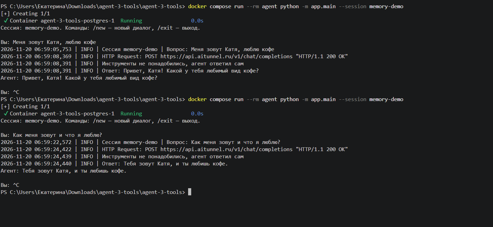
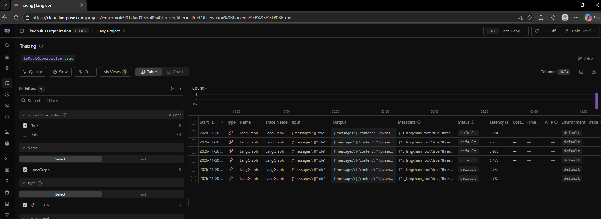
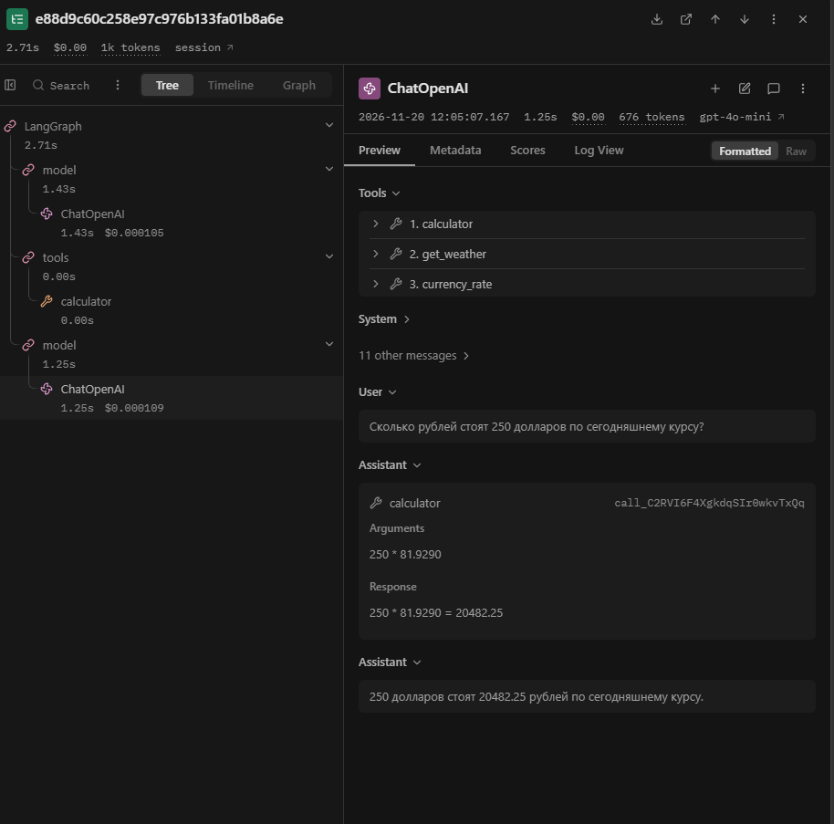

# Агент с 3 инструментами

Консольный агент на LangChain / LangGraph. В зависимости от вопроса пользователя он сам выбирает нужный инструмент:

| Инструмент | Что делает | Источник данных |
|---|---|---|
| `calculator` | считает арифметические выражения | безопасный разбор выражения через `ast` |
| `get_weather` | текущая погода в городе | open-meteo.com (без ключа) |
| `currency_rate` | курс валюты ЦБ РФ к рублю | cbr-xml-daily.ru (без ключа) |

Дополнительно:
- **логирование** — в консоль и в файл `logs/agent.log` пишется, какой инструмент выбрал агент, с какими аргументами и что получил;
- **память диалога** — история хранится в Postgres через `langgraph-checkpoint-postgres` и сохраняется после перезапуска;
- **трейсинг** — все запуски отправляются в Langfuse, диалоги группируются по сессиям;
- **запуск в Docker** — `docker compose` поднимает агента и Postgres.

Модель: `gpt-4o-mini` через OpenAI-совместимый API (AITunnel), можно заменить в `.env`.

## Структура

```
├── app/
│   ├── main.py      # консольный чат, демо-режим, Postgres-память, Langfuse
│   ├── agent.py     # создание агента и middleware для логирования инструментов
│   └── tools.py     # 3 инструмента
├── logs/            # сюда пишется agent.log
├── Dockerfile
├── docker-compose.yml
├── requirements.txt
└── .env.example
```

## Как работает

```
Вопрос → агент (LLM) → выбирает инструмент → middleware пишет в лог → инструмент → ответ
                 ↑                                                          │
                 └──────── история диалога из Postgres (thread_id) ─────────┘
```

Агент создаётся через `create_agent` из LangChain. Логирование сделано через middleware `wrap_tool_call`: он срабатывает перед каждым вызовом инструмента и после него. Память — `PostgresSaver`, id диалога передаётся как `thread_id`. Этот же id передаётся в Langfuse как `session_id`.

## Запуск

1. Скопировать `.env.example` в `.env` и вписать ключи:
   ```
   AITUNNEL_API_KEY=...
   LANGFUSE_PUBLIC_KEY=...
   LANGFUSE_SECRET_KEY=...
   ```
2. Собрать образ:
   ```
   docker compose build
   ```
3. Демо-режим (6 готовых вопросов на все инструменты и память):
   ```
   docker compose run --rm agent python -m app.main --demo
   ```
4. Интерактивный чат:
   ```
   docker compose run --rm agent
   ```
   Команды в чате: `/new` — новый диалог, `/exit` — выход.
5. Проверка памяти после перезапуска:
   ```
   docker compose run --rm agent python -m app.main --session test-memory
   # написать "Меня зовут Анна", выйти через /exit
   docker compose run --rm agent python -m app.main --session test-memory
   # спросить "Как меня зовут?"
   ```
6. Остановить Postgres:
   ```
   docker compose down        # данные памяти сохраняются
   docker compose down -v     # удалить и память
   ```

## Пример лога

Фрагмент `logs/agent.log` из демо-режима (`--demo`):

```
2026-11-20 06:51:33,219 | INFO | Сессия demo-81e23d | Вопрос: Сколько будет (125 + 375) * 4 / 8?
2026-11-20 06:51:34,524 | INFO | Агент выбрал инструмент: calculator | аргументы: {'expression': '(125 + 375) * 4 / 8'}
2026-11-20 06:51:34,526 | INFO | Результат calculator: (125 + 375) * 4 / 8 = 250.0
2026-11-20 06:51:35,886 | INFO | Ответ: Результат вычисления (125 + 375) * 4 / 8 равен 250.0.
2026-11-20 06:51:35,887 | INFO | Сессия demo-81e23d | Вопрос: Какая сейчас погода в моём городе?
2026-11-20 06:51:37,121 | INFO | Агент выбрал инструмент: get_weather | аргументы: {'city': 'Казань'}
2026-11-20 06:51:39,765 | INFO | Результат get_weather: Казань (Россия): 3.6°C, ветер 16.1 км/ч
2026-11-20 06:51:41,106 | INFO | Ответ: В Казани сейчас температура 3.6°C, ветер 16.1 км/ч.
2026-11-20 06:51:41,107 | INFO | Сессия demo-81e23d | Вопрос: Какой сегодня курс доллара и евро?
2026-11-20 06:51:42,666 | INFO | Агент выбрал инструмент: currency_rate | аргументы: {'code': 'USD'}
2026-11-20 06:51:42,667 | INFO | Агент выбрал инструмент: currency_rate | аргументы: {'code': 'EUR'}
2026-11-20 06:51:43,774 | INFO | Результат currency_rate: 1 EUR (Евро) = 89.8597 руб. (вчера 90.3605), дата 2026-11-20
2026-11-20 06:51:43,776 | INFO | Результат currency_rate: 1 USD (Доллар США) = 81.9290 руб. (вчера 82.2281), дата 2026-11-20
2026-11-20 06:51:45,052 | INFO | Ответ: Сегодня курс доллара составляет 81.9290 руб., а курс евро — 89.8597 руб.
2026-11-20 06:51:45,053 | INFO | Сессия demo-81e23d | Вопрос: Сколько рублей стоят 250 долларов по сегодняшнему курсу?
2026-11-20 06:51:46,377 | INFO | Агент выбрал инструмент: calculator | аргументы: {'expression': '250 * 81.9290'}
2026-11-20 06:51:46,378 | INFO | Результат calculator: 250 * 81.9290 = 20482.25
2026-11-20 06:51:47,663 | INFO | Ответ: 250 долларов стоят 20482.25 рублей по сегодняшнему курсу.
2026-11-20 06:51:47,664 | INFO | Сессия demo-81e23d | Вопрос: Как меня зовут и где я живу?
2026-11-20 06:51:48,895 | INFO | Инструменты не понадобились, агент ответил сам
2026-11-20 06:51:48,895 | INFO | Ответ: Тебя зовут Анна, и ты живешь в Казани.
```

Что видно в логе:
- для каждого вопроса записано, какой инструмент выбрал агент и с какими аргументами;
- город для погоды агент взял из памяти — в вопросе его не было, пользователь назвал его в первом сообщении;
- для курса двух валют агент вызвал `currency_rate` два раза;
- для пересчёта долларов в рубли агент использовал курс из предыдущего ответа и вызвал `calculator`;
- на вопросы без вычислений и внешних данных агент отвечает сам.

## Скриншоты

### Логи выбора инструментов
Демо-режим: агент по очереди выбирает `calculator`, `get_weather` и `currency_rate`.


### Память диалога
Два отдельных запуска контейнера с одной сессией `memory-demo`: во втором запуске агент помнит имя и что любит пользователь — история берётся из Postgres.



### Langfuse: список запусков
6 запусков демо-режима, по одному на каждый вопрос.



### Langfuse: трейс с вызовом инструмента
Вопрос «Сколько рублей стоят 250 долларов»: модель → `calculator` (`250 * 81.9290 = 20482.25`) → модель. Видны доступные агенту инструменты, модель `gpt-4o-mini`, токены и стоимость.


