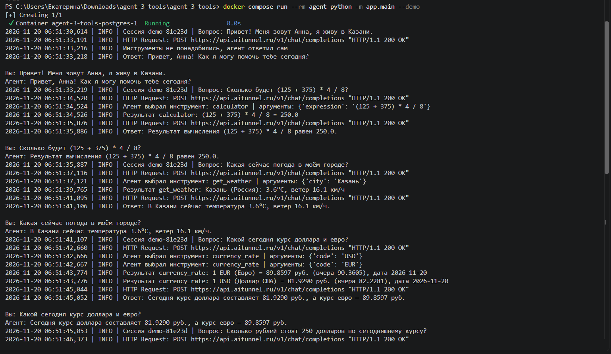

# Агент с 3 инструментами

Консольный агент на LangChain / LangGraph. В зависимости от вопроса пользователя он сам выбирает нужный инструмент:

| Инструмент | Что делает | Источник данных |
|---|---|---|
| `calculator` | считает арифметические выражения | безопасный разбор выражения через `ast` |
| `get_weather` | текущая погода в городе | open-meteo.com (без ключа) |
| `currency_rate` | курс валюты ЦБ РФ к рублю | cbr-xml-daily.ru (без ключа) |

Дополнительно:
- **логирование** — в консоль и в файл `logs/agent.log` пишется, какой инструмент выбрал агент, с какими аргументами и что получил;
- **память диалога** — история хранится в Postgres через `langgraph-checkpoint-postgres` и сохраняется после перезапуска;
- **трейсинг** — все запуски отправляются в Langfuse, диалоги группируются по сессиям;
- **запуск в Docker** — `docker compose` поднимает агента и Postgres.

Модель: `gpt-4o-mini` через OpenAI-совместимый API (AITunnel), можно заменить в `.env`.

## Структура

```
├── app/
│   ├── main.py      # консольный чат, демо-режим, Postgres-память, Langfuse
│   ├── agent.py     # создание агента и middleware для логирования инструментов
│   └── tools.py     # 3 инструмента
├── logs/            # сюда пишется agent.log
├── Dockerfile
├── docker-compose.yml
├── requirements.txt
└── .env.example
```

## Как работает

```
Вопрос → агент (LLM) → выбирает инструмент → middleware пишет в лог → инструмент → ответ
                 ↑                                                          │
                 └──────── история диалога из Postgres (thread_id) ─────────┘
```

Агент создаётся через `create_agent` из LangChain. Логирование сделано через middleware `wrap_tool_call`: он срабатывает перед каждым вызовом инструмента и после него. Память — `PostgresSaver`, id диалога передаётся как `thread_id`. Этот же id передаётся в Langfuse как `session_id`.

## Запуск

1. Скопировать `.env.example` в `.env` и вписать ключи:
   ```
   AITUNNEL_API_KEY=...
   LANGFUSE_PUBLIC_KEY=...
   LANGFUSE_SECRET_KEY=...
   ```
2. Собрать образ:
   ```
   docker compose build
   ```
3. Демо-режим (6 готовых вопросов на все инструменты и память):
   ```
   docker compose run --rm agent python -m app.main --demo
   ```
4. Интерактивный чат:
   ```
   docker compose run --rm agent
   ```
   Команды в чате: `/new` — новый диалог, `/exit` — выход.
5. Проверка памяти после перезапуска:
   ```
   docker compose run --rm agent python -m app.main --session test-memory
   # написать "Меня зовут Анна", выйти через /exit
   docker compose run --rm agent python -m app.main --session test-memory
   # спросить "Как меня зовут?"
   ```
6. Остановить Postgres:
   ```
   docker compose down        # данные памяти сохраняются
   docker compose down -v     # удалить и память
   ```

## Пример лога

```
<вставить фрагмент logs/agent.log после запуска>
```

## Скриншоты

### Логи выбора инструментов


### Память диалога


### Langfuse: список запусков


### Langfuse: трейс с вызовом инструмента

